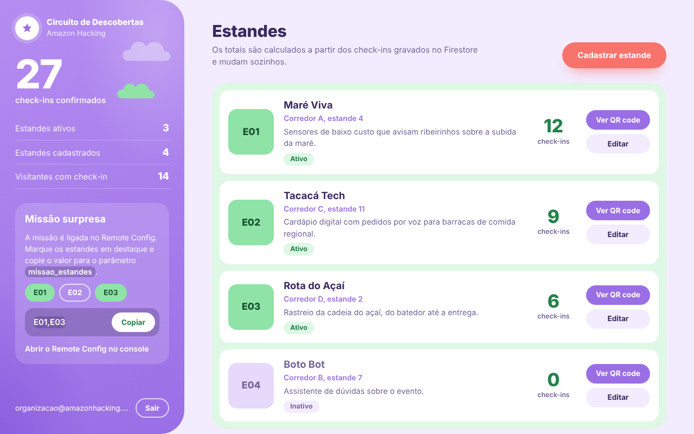

# Circuito de Descobertas

Sistema para incentivar a circulação de visitantes no Amazon Hacking: a organização cadastra estandes e
lança uma missão surpresa; os visitantes recebem a missão no app e registram a visita lendo o QR code do estande.

| Parte | Tecnologia | Pasta |
|---|---|---|
| Painel web da organização | HTML, CSS e JavaScript (SDK web do Firebase por CDN, sem build) | `web-admin/` |
| App do visitante | Flutter (Android) | `app/` |
| Dados e acesso | Cloud Firestore e Firebase Authentication | `firestore.rules` |
| Missão surpresa | Firebase Remote Config com atualização em tempo real | `remoteconfig.template.json` |
| Medição | Google Analytics para Firebase (GA4) | `app/lib/services/analytics_service.dart` |
| Preparação e build do app | Script Dart (gera `android/`, verifica e compila) | `tools/preparar.dart` |
| Distribuição | Firebase App Distribution | `tools/distribuir.sh` |

Tudo funciona no plano Spark, sem cartão.

## Como os dados estão organizados

```
estandes/{estandeId}            estandeId legível, ex.: E01
  nome, descricao, localizacao, ativo, criadoEm, atualizadoEm

checkins/{visitanteId}_{estandeId}
  visitanteId, estandeId, criadoEm

admins/{uid}                    criado à mão no console; define quem é administrador
```

- O QR code de cada estande contém `circuito://estande/<estandeId>`.
- O ID do check-in é a chave composta `visitante_estande`. Regravar o mesmo documento seria um `update`,
  que as regras negam; por isso não existe visita duplicada, nem com dois toques simultâneos.
- O total por estande no painel é contado a partir dos documentos de `checkins`, em tempo real.

### Regras de acesso (`firestore.rules`)

| Quem | Pode |
|---|---|
| Administrador (tem documento em `admins/`) | criar e editar estandes, ler todos os estandes e todos os check-ins |
| Visitante (sessão anônima) | listar estandes ativos, criar check-in da própria identidade em estande ativo, ler os próprios check-ins |
| Ninguém | apagar estandes, alterar ou apagar check-ins, escrever em `admins/` |

Um visitante que lê o QR de um estande inativo recebe `permission-denied` na leitura; o app traduz isso
como “Estande inativo”. Um ID que não existe volta como documento inexistente: “QR code inválido”.

### Parâmetros do Remote Config

| Parâmetro | Tipo | Padrão local no app | Uso |
|---|---|---|---|
| `missao_ativa` | Booleano | `false` | liga e desliga a missão |
| `missao_estandes` | String | vazio | IDs em destaque: `E01,E03` (também aceita `["E01","E03"]`) |
| `missao_titulo` | String | `Missão surpresa` | título da chamada (opcional) |
| `missao_descricao` | String | texto padrão | texto de apoio (opcional) |

### Eventos do Analytics

| Evento | Quando | Parâmetros |
|---|---|---|
| `missao_aberta` | o visitante abre a tela da missão | `qtd_estandes` |
| `checkin_concluido` | depois que o check-in foi gravado no Firestore | `estande_id`, `em_missao` |

## Passo a passo

Pré-requisitos: Flutter 3.47 ou mais novo, Android Studio (Android SDK e emulador), Node.js (para a
Firebase CLI) e Git. Os comandos são rodados no terminal, a partir da raiz do repositório, salvo
quando indicado.

### 1. Projeto no Firebase

1. Crie o projeto em <https://console.firebase.google.com> **com o Google Analytics ativado**.
2. **Authentication → Método de login**: ative **E-mail/senha** e **Anônimo**.
3. **Firestore Database → Criar banco de dados** (modo de produção, qualquer região).
4. No terminal, na raiz do repositório, instale a CLI e selecione o projeto:

```bash
npm install -g firebase-tools
firebase login
firebase use --add
```

### 2. Regras do Firestore

```bash
firebase deploy --only firestore:rules
```

### 3. Administrador

1. **Authentication → Usuários → Adicionar usuário**: crie o e-mail e a senha da organização.
2. Copie o **UID** desse usuário.
3. **Firestore → Iniciar coleção** `admins` → ID do documento = o UID copiado → um campo qualquer, por exemplo `nome: "Organização"`.

Se você entrar no painel antes de fazer o item 3, ele mostra o UID e o que falta.

### 4. Painel web

O painel é a parte da organização e roda no navegador; por isso é registrado no Firebase como app Web.
O app Android é registrado separadamente, no passo 5.

1. **Configurações do projeto → Seus apps → Web (`</>`)**: registre um app e copie a configuração.
2. Cole em `web-admin/firebase-config.js`.
3. Rode localmente:

```bash
npx serve web-admin
```

Ou publique no Firebase Hosting (gratuito):

```bash
firebase deploy --only hosting
```

No painel vazio há um botão **Criar 3 estandes de exemplo** (E01, E02 e E03).

### 5. App Flutter

#### 5.1 Gerar a pasta Android e verificar o código

```bash
dart tools/preparar.dart
```

O script gera a pasta `app/android/` (se ainda não existir), baixa as dependências e roda
`flutter analyze` e `flutter test`. Ele deve terminar em `=== Pronto ===`.

#### 5.2 Ligar o app ao Firebase

```bash
cd app
dart pub global activate flutterfire_cli
flutterfire configure --platforms=android
```

Escolha o projeto criado no passo 1. O comando registra o app Android no projeto e gera
`lib/firebase_options.dart` e `android/app/google-services.json`.

#### 5.3 Preparar um dispositivo

O app roda em um celular Android ou no emulador do Android Studio.

- **Emulador**: no Android Studio, **Device Manager → + → Create Virtual Device**, escolha um Pixel e uma
  imagem de sistema **com Google Play** (necessária para entrar numa conta Google e receber convites do
  App Distribution). Inicie o emulador pelo botão ▶ e espere a tela inicial do Android.
- **Celular**: ative as **Opções do desenvolvedor → Depuração USB** e conecte pelo cabo.

Confira se o dispositivo aparece:

```bash
flutter devices
```

#### 5.4 Rodar o app

Ainda dentro de `app/`:

```bash
flutter run
```

O Flutter instala e abre o app no dispositivo listado. Com o painel aberto, crie os estandes de exemplo:
eles aparecem no app sem recarregar.

#### Leitura de QR code no emulador

A câmera do emulador é virtual. Há duas formas de mostrar um QR code a ela:

- **Webcam do computador**: no Device Manager, edite o emulador (ícone de lápis) →
  **Show Advanced Settings** → **Back camera: Webcam0**. Depois aponte a webcam para o QR impresso ou
  aberto em outra tela.
- **Imagem na cena virtual**: com o emulador aberto, **⋯ (Extended controls) → Camera** e escolha a
  imagem do QR em **Wall**. Na câmera do app, segure Alt e mova o mouse para enquadrar a parede.

Os detalhes da pasta Android e da assinatura estão em `docs/android.md`.

### 6. Remote Config

Opção A, pela CLI (**sobrescreve** o modelo que estiver publicado no projeto):

```bash
firebase deploy --only remoteconfig
```

Opção B, pelo console: **Remote Config → Criar configuração** e adicione os parâmetros da tabela acima.

Para ligar a missão: mude `missao_ativa` para `true`, ajuste `missao_estandes` e clique em **Publicar alterações**.
O app aberto recebe a mudança em poucos segundos, sem reiniciar. No painel web, o bloco “Missão surpresa”
monta o valor de `missao_estandes` para você copiar.

### 7. APK assinado e App Distribution

```bash
dart tools/preparar.dart apk
```

Cria a chave de assinatura na primeira vez, gera o APK de release assinado em
`app/build/app/outputs/flutter-apk/app-release.apk` e mostra o certificado. O envio para os testadores
está na seção 5 de `docs/android.md`. Para instalar pelo convite no emulador, entre no Gmail pelo
Chrome do emulador com o e-mail do testador e permita a instalação de fontes desconhecidas para o Chrome.

### 8. Analytics

Os eventos saem do app instalado normalmente. Abra **Analytics → Relatórios → Tempo real**; no cartão
**Contagem de eventos por Nome do evento** aparecem `missao_aberta` e `checkin_concluido`. Clique em
`checkin_concluido` → `estande_id` para ver o valor (ex.: `E03`).

Os eventos podem levar de alguns segundos a alguns minutos. Para acompanhar na hora, ative o modo de
depuração e use o **DebugView**:

```bash
adb shell setprop debug.firebase.analytics.app br.cesupa.circuito_descobertas
# para desligar:
adb shell setprop debug.firebase.analytics.app .none.
```

## Onde cada funcionalidade está

| Funcionalidade | Onde |
|---|---|
| Autenticar administrador | `web-admin/app.js` (login por e-mail e senha + checagem em `admins/`) |
| Cadastrar e editar estandes (nome, descrição, localização, ativo) | `web-admin/app.js`, diálogo “Cadastrar estande” |
| QR code por estande, abrir em outra tela ou imprimir | `web-admin/qr.html` |
| Total de check-ins por estande em tempo real | `web-admin/app.js`, `escutarDados()` |
| Listar estandes ativos com a missão desligada | `app/lib/screens/home_screen.dart` |
| Ler QR, validar e dar retorno (inválido, inativo, já registrado, sucesso) | `app/lib/services/checkin_service.dart`, `app/lib/widgets/resultado_sheet.dart` |
| Uma visita por estande e por visitante | chave composta em `checkin_service.dart` + `firestore.rules` |
| Missão por Remote Config, padrão local desligado, tempo real | `app/lib/services/missao_service.dart` |
| Chamada, destaques e tela da missão | `home_screen.dart`, `missao_screen.dart` |
| Regras de acesso | `firestore.rules` |
| Eventos `missao_aberta` e `checkin_concluido` com `estande_id` | `app/lib/services/analytics_service.dart` |

## Identidade visual

Baseada na referência da equipe: céu em degradê lilás com nuvens menta, títulos em Montserrat, campos e
botões em pílula, cartões brancos sobre um bloco menta e um único ponto coral para a ação principal
(“Ler QR code” no app, “Cadastrar estande” no painel). As cores ficam em `app/lib/theme/app_theme.dart`
e no topo de `web-admin/styles.css`.


